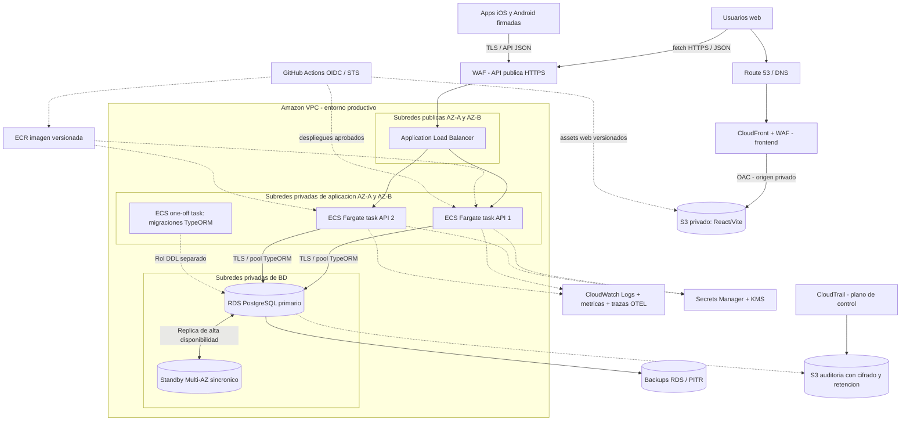

# Treo Wallet — Propuesta de despliegue productivo en AWS

**Tarea:** T-30 · **Requisito:** RNF-11 · **Versión documental:** 1.0 · **Fecha:** 2026-10-23
**Estado:** arquitectura propuesta, **no desplegada, no probada ni certificada**.
**Fuentes internas:** `specs/treo-assessment-original.md` (Fase 4), `specs/requirements.md` v0.3, `specs/design.md`, `specs/openapi.json` y `specs/tasks.md`.

> **Alcance:** responde al ejercicio de arquitectura para una eventual operación financiera regulada; Treo Wallet **hoy es una simulación en MXN**. No procesa SPEI, dinero real ni KYC. Este documento no constituye un diseño aprobado por un área de seguridad, cumplimiento o continuidad de negocio. **T-30 no crea recursos ni ejecuta despliegues AWS.** Los valores de SLO, RPO, RTO y retención son **objetivos propuestos**, sujetos a aprobación y pruebas.

## 1. Decisión ejecutiva

**Propuesta inicial:** mantener la **API modular única** Node.js/Express/TypeScript en contenedores sobre **Amazon ECS con AWS Fargate**, expuesta a través de un **Application Load Balancer (ALB)** HTTPS con **AWS WAF**. Usar **Amazon RDS for PostgreSQL** en configuración **Multi-AZ DB instance**, con copias de seguridad automatizadas y recuperación a un punto en el tiempo (**PITR**). Servir el build estático de **React/Vite** desde un bucket **S3 privado** mediante **CloudFront con Origin Access Control (OAC)**. Distribuir el cliente Expo/React Native como aplicaciones firmadas en las tiendas, no desde ECS.

**Por qué:** reduce la operación de servidores y Kubernetes; conserva los invariantes financieros dentro de una única transacción PostgreSQL; permite escalar la capa de API horizontalmente sin introducir comunicación entre microservicios; tiene rutas explícitas para CI/CD, observabilidad, control de acceso y recuperación. **No** se propone pasar a microservicios por el hecho de usar AWS.

### 1.1 Supuestos de dimensionamiento — no mediciones

| Dimensión | Supuesto inicial para diseñar | Validación requerida antes de producción |
|---|---|---|
| Carga | Pequeña a mediana; picos variables y transacciones cortas | RPS, p95/p99, usuarios simultáneos, tamaño de transferencias y contención de filas |
| Disponibilidad | Servicio web/API en **dos zonas de disponibilidad (AZ)** | Pruebas controladas de failover y balanceador |
| Datos | Una región principal; escrituras financieras en un único PostgreSQL primario | Capacidad, IOPS, índices, particionado, backups y replay |
| Entornos | `dev`, `staging`, `prod` aislados | IAM, permisos, redes y gastos separados |
| Región | Elegir región AWS tras evaluar residencia de datos, latencia, servicios y condiciones legales | Aprobación de seguridad/legal; **no se asume región ni residencia obligatoria** |
| Cumplimiento | Posible empresa regulada, sin marco legal determinado por el ejercicio | Evaluación de legislación mexicana aplicable y controles contractuales por especialistas |

## 2. Diagrama de arquitectura propuesta

**Lectura del diagrama:** CloudFront entrega **únicamente activos estáticos web**; las rutas API permanecen sin caché y terminan en ALB. El texto `api.treo.example` es ilustrativo, **no es un dominio real**. La BD es privada, sin IP pública, y el standby no es una réplica de lectura general: su papel inicial es failover. CloudTrail audita **acciones AWS**, no sustituye `audit_events` de la aplicación. Las flechas de CI/CD y la migración son pasos **propuestos**, no automatizaciones ya existentes.

**Networking:** ALB en subredes públicas con certificados ACM y redirección HTTP→HTTPS; tasks ECS en subredes privadas, `assignPublicIp=false`; RDS en subredes de datos privadas, sin acceso directo desde Internet. `security groups`: entrada ALB 443 desde red pública/WAF; ECS puerto API **solo** desde SG de ALB; RDS TCP 5432 **solo** desde SG ECS y SG temporal de migraciones. Tráfico saliente restringido según dependencias; preferir VPC endpoints para ECR/S3/CloudWatch/Secrets Manager cuando el análisis costo/seguridad lo justifique; NAT únicamente donde sea necesario. TLS también hacia PostgreSQL, usando validación de certificado.

## 3. Cómputo API: elección y descartes explícitos

| Opción | Evaluación para esta API financiera | Decisión |
|---|---|---|
| **ECS + Fargate** | Contenedor Express de larga duración; escalado de tasks por CPU/memoria y métricas HTTP, health checks, despliegue gradual y red privada. Control suficiente sobre recursos y conexión DB sin gestionar nodos. | **Elegida** |
| **AWS App Runner** | Despliegue simple y poca operación; buena opción para API pequeña. Menor flexibilidad de topología/control de plataforma y de estrategias operativas avanzadas comparada con ECS+ALB para este escenario. Puede revisitarse si predomina la simplicidad/costo. | Descartada inicialmente, no por incompatibilidad |
| **Amazon EKS** | Aporta plataforma Kubernetes, políticas y operadores; con un solo servicio API genera carga operativa y superficie de complejidad sin demanda demostrada. | Descartada hasta necesitar Kubernetes a escala organizacional |
| **Lambda + API Gateway** | Escala por invocación y reduce cómputo ocioso, pero requiere adaptar Express/operación, controlar concurrencia y proteger la base de una explosión de conexiones. Viable con adaptación y Proxy; menor continuidad con el runtime actual. | Descartada para el baseline, no por imposibilidad técnica |

**Configuración propuesta:** imagen Node.js fijada por digest en ECR, contenedor sin privilegios/root, filesystem de solo lectura cuando sea compatible, recursos `cpu`/memoria derivados de pruebas, **2 tasks mínimos repartidos en 2 AZ en producción**, deployment rolling con `minimumHealthyPercent`, alarmas y rollback; health endpoint liviano `/healthz` **solo si se implementa** (no afirmar que existe). Gracia de inicio y terminación para drenar requests; la API debe cerrar conexiones DB correctamente. Probes de vida/disponibilidad separadas si se necesita comprobar DB.

**Dinero y escalado:** las transacciones TypeORM siguen siendo la fuente de verdad, con `SELECT … FOR UPDATE` en orden determinista, `BIGINT` de centavos, límite por día `America/Mexico_City`, `Idempotency-Key` y trigger diferido del ledger. Redis, SQS, caché, Fargate o un ALB **no** deben reemplazar estas garantías; todas las tasks comparten el mismo estado persistido y **ninguna** depende de memoria local para decidir si un cargo existe.

## 4. PostgreSQL: RDS frente a Aurora, Multi-AZ y recuperación

### 4.1 Servicio elegido

**Amazon RDS for PostgreSQL Multi-AZ DB instance**, con versión mayor compatible (PostgreSQL 15+), almacenamiento cifrado en reposo (KMS), cifrado en tránsito, logs SQL sanitizados, ventanas de mantenimiento, parámetros y límites de conexiones medidos. Conservar **TypeORM `synchronize: false`** y migraciones versionadas; las migraciones requieren **identidad de BD separada del usuario de la aplicación**. El rol API es mínimo (`SELECT/INSERT/UPDATE` puntuales), con `audit_events` insert/select sin `UPDATE`, `DELETE` ni `TRUNCATE`; validar las restricciones DB usando ese mismo rol.

**Por qué no Aurora desde el inicio:** Aurora PostgreSQL es una alternativa seria para cargas mayores, réplicas y requisitos específicos de latencia/disponibilidad. No existe evidencia actual de que el MVP necesite esas prestaciones adicionales; RDS PostgreSQL se parece más al entorno validado y reduce variables a migrar. Reevaluar tras carga real, comparación TCO, restore drill y pruebas de compatibilidad de funciones/triggers y locks. **Multi-AZ no sustituye backup:** protege contra falla de infraestructura/AZ, no contra borrado lógico ni un bug de escritura.

### 4.2 Backups, PITR y objetivos de recuperación

- **Backups automatizados de RDS** con retención inicial **35 días en prod** (*propuesta operativa, no norma*); restauración PITR desde instantes disponibles de la ventana. Snapshots manuales antes de migraciones riesgosas; revisar retención/lifecycle y copias de respaldo según riesgo. Habilitar protección contra borrado para prod, cifrado, IAM mínimo y alertas de fallo de backup.
- **Multi-AZ DB instance:** standby sincronizado en otra AZ, failover gestionado por RDS; la aplicación abre nuevas conexiones/renueva DNS después del cambio. AWS documenta que el failover típico puede durar 60–120 s, **pero no es un SLO garantizado** y puede durar más según carga y recuperación.
- **PITR no rebobina el primario in place:** crea una instancia restaurada; requiere cambio de endpoint, revalidación de migraciones/privilegios y conciliación de transferencias contra evidencia de negocio. No hacer replay de transferencias ni reintentar pagos con nuevos IDs sin conciliación.

| Escenario | RPO objetivo propuesto | RTO objetivo propuesto | Cómo se comprobaría |
|---|---|---|---|
| Pérdida de instancia/AZ con Multi-AZ | **0 transacciones confirmadas** como meta de integridad; sujeto a pruebas | **≤ 15 min** | Simulacro failover + reconciliación de saldos/ledger e idempotencia |
| Error lógico/borrado accidental recuperado por PITR | **≤ 15 min** de pérdida potencial máxima aceptable, **no garantizado** por configurar PITR | **≤ 4 h** | Restaurar punto seguro en staging, comparar tablas/ledger/auditoría y conmutar |
| Caída regional completa | **Sin RPO/RTO comprometido** con arquitectura de una región | **Sin RPO/RTO comprometido** | Requiere decisión comercial sobre segunda región/backups replicados y DR |

**Condición de salida a producción:** los valores anteriores deben aprobarse por negocio y corroborarse en pruebas repetibles (incluido `LatestRestorableTime` observado y conciliación financiera). Un RTO prometido sin restore drill es solo una intención. Para un negocio regulado evaluar copias entre cuentas/regiones, planes de ransomware y requisitos de residencia; esto incrementa costo y complejidad.

## 5. Conexiones PostgreSQL con escalado horizontal

ECS escala tasks, no la capacidad de conexiones de PostgreSQL. Cada task comparte el pool de TypeORM para peticiones concurrentes: **conexiones máximas aproximadas = tasks × pool_max + conexiones de migración/operaciones**. Ejemplo **hipotético**: 2 tasks × 10 = 20; a 50 tasks × 10 = 500, sin contar administración y procesos externos.

**Primera medida:** pool pequeño y medido por task (p. ej. `max=10` solo como supuesto inicial, no parámetro probado), límites de cola/timeout, cerrar transacciones rápido, una sola conexión/pool por proceso y alertas por `DatabaseConnections`, CPU/IO y locks; limitar máximo de tasks según presupuesto total de conexiones. No aumentar el pool por intuición; simular estrés con transferencias concurrentes y validar que sigue habiendo cero inconsistencias.

**Si se observa presión:** considerar **RDS Proxy** para pooling y resistencia a cambios de endpoint. **Precaución importante con PostgreSQL:** `SET`, sentencias preparadas, cursores y otros cambios de estado pueden causar **session pinning** y anular parte del multiplexado; medir `DatabaseConnectionsCurrentlySessionPinned` y revisar cómo TypeORM/driver usan sesiones antes de declarar mejoras. Proxy **no elimina** los bloqueos de fila, los límites de la BD ni la necesidad de transacciones cortas. Una réplica de lectura futura solo atendería reportes tolerantes a lag; **saldos, cupos, comprobantes e idempotencia van al primario** para no tomar decisiones con datos desactualizados.

## 6. Frontend web y distribución móvil

### Web: S3 + CloudFront (elegido) vs Amplify Hosting

El build `web/dist/` de Vite se publica con asset hashes e `index.html` con TTL corto. **Bucket S3 privado** (Block Public Access), **CloudFront OAC** con origen S3 **regular, no website endpoint**, certificado ACM, HTTPS obligatorio, cabeceras CSP/HSTS y política de caché que no cachea respuestas API. `index.html` y rutas de React SPA requieren regla de fallback controlada **solo en la distribución web**. La URL API pública se parametriza en el build de frontend y no lleva credenciales.

**Amplify Hosting** también serviría el SPA con integración Git simplificada; se elige S3+CloudFront porque se busca control explícito de buckets, CDN, IAM y despliegue desde CI para una plataforma auditada. Evitar secretos en variables `VITE_*`: son públicas al compilar.

### Web → API (sesión)

Proponer dominios separados del mismo sitio (`app.example` y `api.example`, ambos HTTPS); permitir en CORS únicamente el origen web esperado con credenciales si se utiliza refresh cookie HttpOnly, `Secure`, `SameSite` diseñado para la topología real y comprobación de `Origin`/CSRF en endpoints sensibles. Cookies son propias del host API, no de S3/CloudFront. La respuesta autenticada de la API se entrega con `Cache-Control: no-store`. Revisar el comportamiento del cliente actual antes de configurar dominios definitivos.

### Móvil

El código Expo/React Native se prepara en un **build nativo de distribución** firmado para App Store/TestFlight y Google Play (EAS Build/Submit o un pipeline equivalente aprobado). Expo Go **no** se presenta como aplicación productiva; las credenciales de firma se manejan en el servicio de build/gestor de secretos, con acceso mínimo, rotación y separación por entorno. La app se comunica con API HTTPS, nunca accede directamente a RDS ni incluye secretos AWS; access JWT en memoria, refresh en Keychain/Keystore vía `expo-secure-store` según el diseño actual. Datos públicos de entorno (URL API) son configurables por build; sin OTP fijo de demostración ni URL HTTP en producción. Evaluar y probar protección nativa contra snapshots, attestation/pinning y publicación controlada, sin afirmarlas como implementadas.

## 7. Seguridad, observabilidad y auditoría

| Capa | Controles propuestos | Señales/alertas |
|---|---|---|
| Borde web/API | TLS ACM, WAF managed rules y rate limits, ALB sin acceso directo a tasks, CSP/HSTS | 4xx/5xx, p95/p99, WAF blocks, latencia ALB, salud targets |
| Identidad/secretos | IAM least privilege, roles separados ECS task/execution/CI/migración, Secrets Manager+KMS, rotación con redeploy controlado | Acceso anómalo a secretos, autenticación fallida, cambios IAM |
| App/API | JSON logs `requestId`, trace ID, operación redacted, sin JWT/refresh/OTP/password/CLABE íntegra; RFC 7807; no stacktraces al cliente | Errores de transferencias, intentos OTP, fallas de refresh, reintentos idempotentes |
| Instrumentación | CloudWatch Logs/metrics/alarms + OpenTelemetry (trazas exportadas a X-Ray o backend elegido), propagación de contexto, muestreo sin secretos | Errores y latencias por ruta, health check y saturación de tareas |
| Base de datos | Performance Insights / métricas RDS según disponibilidad, logs PG sanitizados, alertas de failover/backup, slow queries | CPU, conexiones, memoria, almacenamiento, locks, queries lentas, restore window |
| Auditoría financiera | Tabla **append-only** existente `audit_events`, control de permisos DB, stream/export controlado a S3 cifrado para conservación a largo plazo | Operaciones rechazadas, cambios privilegiados, discordancia saldos/ledger |
| Auditoría AWS | **CloudTrail** para eventos de administración y acciones de control; trail multirregión hacia S3 audit segregado, integridad de logs | Cambio de IAM/KMS/bucket/logging; acceso y borrado sospechoso |

**Distinción importante:** CloudTrail Event history conserva **90 días de management events** por región y no incluye automáticamente eventos de datos ni registros de transferencias. Para auditoría duradera: habilitar **trail** hacia S3 (y data events selectivos si justifican costo), cifrado KMS, bucket con bloqueo de acceso público, protección contra modificación/retención según aprobación y acceso de investigación segregado. Logs de transferencias **no** se sustituyen por CloudTrail.

**Retención inicial propuesta, pendiente de cumplimiento:** CloudWatch aplicación `30 días` en prod y `7 días` en dev; logs operativos de seguridad `90 días`; `audit_events` en PostgreSQL por ventana operativa según tamaño y export histórico cifrado a S3 por `365 días` como **punto de partida para discusión, no exigencia legal verificada**. Retención de CloudTrail/S3 y eventual Object Lock/backup entre cuentas quedan a aprobar por Legal/Compliance y Seguridad. Nunca afirmar que 365 días cumple automáticamente con CNBV, protección de datos o normas mexicanas.

**Operación:** alertar por indisponibilidad, acumulación de 5xx, p95/p99, idempotency conflicts inesperados, fallos de backups, incremento de conexiones, almacenamiento, sospecha de cambios IAM o integridad del ledger. Ejecutar reconciliación contable fuera del camino transaccional, con controles de acceso y evidencia auditada; alerta no equivale a autocorrección de saldos. Tableros y runbooks deben documentar responsables y escalamiento.

## 8. CI/CD, identidades y entornos

**No está implementado en T-30.** El pipeline de comprobaciones del monorepo corresponde a **T-31**; esta sección describe el eventual pipeline de despliegue, no un workflow presente.

1. **PR:** instalar desde lockfile (`npm ci`), lint, typecheck, OpenAPI `--check`, pruebas API+PostgreSQL, web y móvil, análisis de dependencias/imagen e IaC. No otorgar acceso a secretos prod ni desplegar desde PR sin confianza.
2. **Merge a `main`:** build web y contenedor backend versionados por SHA/digest, push a ECR y almacenamiento estático de artefactos; ejecutar smoke/integración en `dev` sin credenciales productivas.
3. **Staging:** promotion del **mismo digest**, migraciones TypeORM aprobadas (una única task temporal y usuario DDL segregado), verificación de saldo/ledger/rollback y pruebas OTP no productivas. Estrategia `expand → migrate → contract` para compatibilidad backward.
4. **Producción:** aprobación humana y reglas de protección de GitHub Environment, despliegue rolling/canary con monitoreo y rollback de **aplicación**. El rollback de migración de BD no se presume reversible; preparar restauración y plan por cambio, no ejecutar `down()` destructivo sin evaluación.
5. **Distribución móvil:** build nativo firmado y probado; aprobación/versionado separado por tiendas, configuración de URL prod y compatibilidad API hacia atrás.

**OIDC GitHub → AWS IAM STS:** usar IdP `token.actions.githubusercontent.com`, condición `aud=sts.amazonaws.com`, restringir `sub` a repositorio/branch/environment permitidos (p. ej. `repo:ORG/REPO:environment:prod` **más reglas de protección del Environment**); separar roles por cuenta/entorno y permisos ECR/ECS/S3 limitados a recursos concretos. Dar al job únicamente `id-token: write` y permisos de lectura de código si proceden; **no** guardar access keys AWS de larga duración en GitHub Secrets. Nunca aceptar `sub='*'`. El token OIDC concede **asumir un rol**, no permisos indiscriminados por sí solo.

**Aislamiento:** preferir cuentas AWS separadas para `dev`, `staging`, `prod` con IAM/CloudTrail/Presupuestos por cuenta. Si temporalmente se comparte cuenta, separar VPC, bases, buckets, secretos, claves y roles rigurosamente y documentar excepciones. Los datos prod nunca se copian a dev sin anonimización/permiso; ninguna task prod debería poder usar la base de staging.

## 9. ¿Qué cambia ante crecimiento de 100×?

1. **Medir primero:** RPS, transferencia/s, latencia DB, bloqueos `FOR UPDATE`, concurrencia por cuenta, saturación de pool, CPU/IO/IOPS, tamaño de índices, coste de logging. Un 100× de lecturas no es igual a un 100× de escrituras sobre las mismas cuentas.
2. **Escalar API horizontalmente:** target tracking ECS con CPU/memoria + requests/ALB; prueba de límite `max tasks` y capacidad de pool. Más tasks no solucionan locks sobre la misma fila.
3. **Controlar DB:** tamaños/IOPS medidos, tuning de queries y buenos índices de historial/cursor; revisar `EXPLAIN (ANALYZE, BUFFERS)` con 100k+ movimientos (ya medido en entorno local durante T-20, pero cifras locales **no predicen** RDS); particionado de tablas voluminosas si el perfil lo exige.
4. **Separar lectura tolerante a consistencia eventual:** reportes/analytics, cache de catálogos inmutables y trabajos asíncronos; **nunca** servir balances de autorización o decisiones de idempotencia desde cache/replica atrasada.
5. **Desacoplar solo trabajo no financiero crítico:** notificaciones, envío de correo y generación de reportes a SQS + workers idempotentes, con patrón transactional outbox si deben dispararse exactamente a partir de commits. **No** introducir envío de dinero asíncrono sin rediseñar la máquina de estados y pruebas.
6. **Reevaluar arquitectura de datos:** RDS Proxy (si no hay pinning limitante), read replicas para reportes, Aurora PostgreSQL si hay evidencia de beneficio y TCO razonable, particionado/sharding solo tras pruebas exhaustivas de atomicidad, cupo diario y ledger. No crear microservicios de pagos prematuramente.
7. **Estrategia de continuidad:** si el negocio exige tolerar caída regional, diseñar segunda región, replicación, procedimiento de promoción y política de reconciliación; revisitar RPO/RTO y costo. No confundir Multi-AZ con Multi-Region.

**Invariante irrenunciable:** `COMPLETED` implica 2 asientos de signos opuestos sumando cero, saldos no negativos y una sola operación por intención; sin garantía verificable de ello no se habilita el crecimiento.

## 10. Infraestructura como código (IaC) y control de cambios

**Elegida:** **Terraform**, con providers AWS versionados, state remoto cifrado en S3 con bloqueo de estado compatible, bucket de estado protegido, `plan` revisado en PR y `apply` solo tras aprobación por entorno. Organizar módulos `network`, `edge`, `compute`, `database`, `observability`, `identity`, `web-hosting`, con variables por `dev/staging/prod` y etiquetas de coste. El rol del pipeline para `plan` debe ser distinto o más restringido que el rol de `apply`.

**Alternativas:** AWS **CDK** sería válido si se prioriza TypeScript y CloudFormation; no se elige porque Terraform resulta cómodo para separación de módulos/estado y flujos de plan/aprobación. **SAM** prioriza aplicaciones serverless y no encaja naturalmente con ECS+RDS como base; puede aplicarse a Lambdas auxiliares futuras, no como herramienta principal. Ninguna IaC se crea ni aplica en T-30: **un esqueleto era bonus y no se incluye para mantener el alcance contractual**.

**Costos y control:** presupuestos/alertas por cuenta y entorno, tags por producto/servicio y revisión FinOps mensual. Mayores impulsores: tasks Fargate permanentes, RDS Multi-AZ + almacenamiento/IOPS + backups, ALB, NAT/VPC endpoints, transferencia CloudFront, WAF, logs/observabilidad y Proxy opcional. Dimensionar con AWS Pricing Calculator usando **región, perfil de tráfico y retención reales**; no es responsable inventar un monto mensual sin datos. `dev` puede usar una task y BD Single-AZ sin representar disponibilidad prod; staging debe probar propiedades HA antes de abrir al público.

## 11. Riesgos, decisiones pendientes y límites explícitos

| Riesgo/decisión | Tratamiento previo a producción |
|---|---|
| OTP actualmente simulado | Reemplazar por segundo factor real con política aprobada, protección anti-replay y revisión antifraude; **no** habilitar OTP fijo en prod |
| Seguridad móvil | Probar builds firmados, tratamiento nativo del selector de apps/snapshots y manejo de secretos; Expo Go solo demo |
| Datos/identidad | DPIA/análisis privacidad, responsabilidades de tratamiento y regulaciones aplicables determinados por Legal/Compliance |
| Continuidad y respaldo | Aprobar RPO/RTO y ensayar fallos AZ, restauración PITR, revocación de secretos y conciliación posterior |
| Auditoría y retención | Definir qué se retiene, en qué región, quién puede consultar y cómo se asegura inmutabilidad con Legal/Compliance |
| Base/roles | Probar en RDS mismo usuario de aplicación con restricciones DB de auditoría y triggers; privilegios de migración separados |
| Seguridad de despliegue | Revisar imágenes/dependencias y cerrar vulnerabilidades de npm abiertas en Bloque 4 antes de go-live |
| Observabilidad | Medir cardinalidad, controlar PII, implementar dashboard, on-call y runbooks con dueños reales |
| Autorización de tráfico | Definir dominio y CORS/CSRF/cookies para producción; comprobar no caché API y refresh desde web |
| Datos reales | Requerir diseño de operación financiera, permisos y certificaciones ajenos a este MVP simulado |

## 12. Checklist de cobertura: enunciado original, Fase 4

| Requisito/pregunta del enunciado | Ubicación de respuesta | Estado documental |
|---|---|---|
| Diagrama de arquitectura en Mermaid | §2 | Cubierto, sin despliegue |
| Cómputo API: ECS Fargate, App Runner, EKS, Lambda/API Gateway y descarte | §3 | Cubierto |
| BD: RDS/Aurora, Multi-AZ, backups, PITR, RPO/RTO | §4 | Cubierto; objetivos no medidos |
| Web: S3+CloudFront vs Amplify Hosting | §6 | Cubierto |
| Móvil: distribución EAS/tiendas y conexión segura | §6 | Cubierto |
| Observabilidad: CloudWatch, X-Ray/OpenTelemetry, CloudTrail, auditoría y retención | §7 | Cubierto; retenciones por aprobar |
| CI/CD: GitHub Actions OIDC, dev/staging/prod | §8 | Cubierto como propuesta; T-31 pendiente |
| Pregunta: conexiones a PostgreSQL, pool y RDS Proxy | §5 | Cubierto |
| Pregunta: ¿qué cambiaría con volumen 100×? | §9 | Cubierto |
| Pregunta: IaC CDK, Terraform o SAM | §10 | Cubierto |
| Restricción: no desplegar AWS | §1, §8 y §10 | Respetada |

## 13. Referencias oficiales AWS consultadas (octubre de 2026)

1. [ECS Service Load Balancing](https://docs.aws.amazon.com/AmazonECS/latest/developerguide/service-load-balancing.html) y [ECS Service Auto Scaling](https://docs.aws.amazon.com/AmazonECS/latest/developerguide/service-auto-scaling.html).
2. [RDS PostgreSQL](https://docs.aws.amazon.com/AmazonRDS/latest/UserGuide/CHAP_PostgreSQL.html), [Multi-AZ failover](https://docs.aws.amazon.com/AmazonRDS/latest/UserGuide/Concepts.MultiAZ.Failover.html), [RDS backups y PITR](https://docs.aws.amazon.com/AmazonRDS/latest/gettingstartedguide/managing-backup-restore.html).
3. [RDS Proxy: session pinning](https://docs.aws.amazon.com/AmazonRDS/latest/UserGuide/rds-proxy-pinning.html).
4. [CloudFront Origin Access Control para S3](https://docs.aws.amazon.com/AmazonCloudFront/latest/DeveloperGuide/private-content-restricting-access-to-s3.html).
5. [CloudTrail Event history y sus límites](https://docs.aws.amazon.com/awscloudtrail/latest/userguide/view-cloudtrail-events.html).
6. [OIDC desde GitHub a IAM con restricción de repositorio/branch](https://docs.aws.amazon.com/IAM/latest/UserGuide/id_roles_create_for-idp_oidc.html).
7. [Objetivos RTO/RPO y simulacros — AWS Well-Architected](https://docs.aws.amazon.com/wellarchitected/latest/reliability-pillar/disaster-recovery-dr-objectives.html).
8. [ECS Secrets Manager: necesidad de redeploy tras rotar variables inyectadas](https://docs.aws.amazon.com/AmazonECS/latest/developerguide/secrets-envvar-secrets-manager.html).
9. [AWS Pricing Calculator](https://calculator.aws/).

---

**Criterio de aceptación de T-30:** documento en el repositorio en `docs/aws-deploy.md`, Mermaid legible, las seis filas y las tres preguntas adicionales respondidas, objetivos distinguibles de mediciones y ausencia de despliegue real. El estado `DONE` y commit SHA se registran **después** de la revisión humana, commit y merge, no en este archivo.
