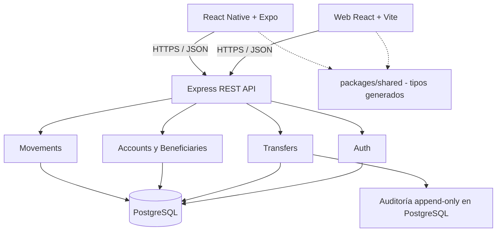
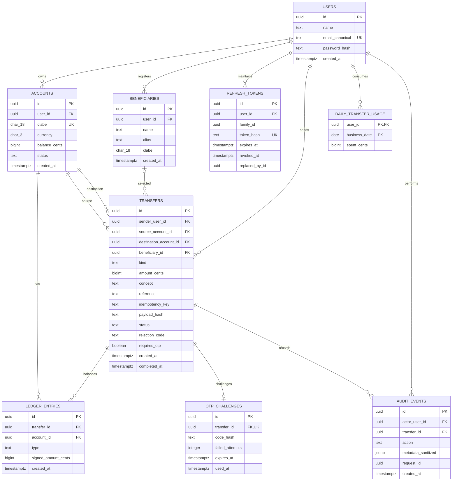
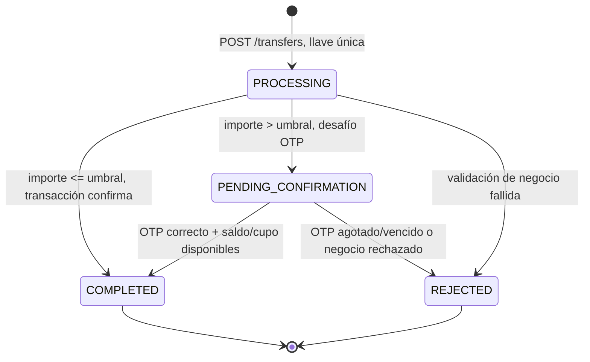
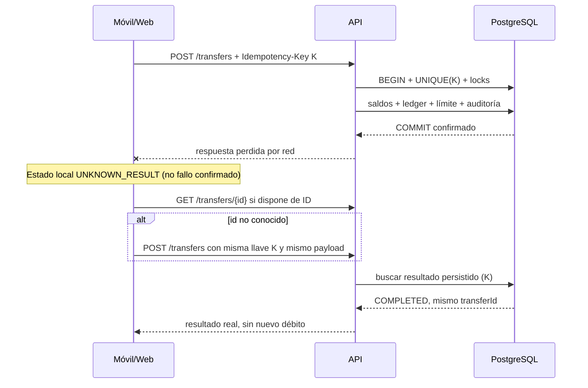

# Treo Wallet — Diseño técnico

**Archivo:** `/specs/design.md`  
**Versión:** 0.1 — **APROBADO** (2026-10-21)  
**Fecha:** 2026-10-21  
**Fuente:** `requirements.md` v0.3 aprobado (RF-01 a RF-14, CA y D-01 a D-08).  
**Contrato OpenAPI 3.1:** [`openapi.json`](./openapi.json), parte normativa de este diseño.  
**Estado de ejecución:** diseño documental; todavía no existen migraciones, servidores funcionales, pruebas ejecutadas ni resultados medidos de `EXPLAIN ANALYZE`.

## 1. Alcance y decisiones arquitectónicas

- **Monorepo npm workspaces**: `/api`, `/web`, `/mobile`, `/packages/shared`, `/specs`, `/docs`.
- **API:** Node.js 24 (cumple 20+), Express, TypeScript `strict`, TypeORM con `synchronize: false`, Zod, PostgreSQL 15+.
- **Web:** React + Vite, TanStack Query, React Hook Form, Zod, Testing Library.
- **Móvil:** Expo + React Native, TypeScript, `expo-secure-store`, TanStack Query; los tipos de contrato serán compartidos.
- **Validación:** `OpenAPI 3.1` es el contrato HTTP; Zod valida solicitudes en el servidor y formularios. `packages/shared` aloja tipos generados del contrato y utilidades de formato/validación sin secretos ni reglas financieras autoritativas.
- **Diseño modular:** `auth`, `accounts`, `beneficiaries`, `transfers`, `movements`, `audit`. `routes/controllers → services → repositories/TypeORM`; los controladores nunca mueven dinero.
- **Dinero:** cadenas decimales en solicitudes; parseo estricto a `bigint` (centavos) en servicios; `BIGINT` en DB; cadenas de centavos en respuestas. Nunca `float`; no redondear.
- **Zona horaria:** timestamps PostgreSQL `timestamptz` UTC; calendario del límite y filtros diarios según `America/Mexico_City`.
- **Flujo contable:** dinero de demostración solo mediante seed aprobado; no se implementa SPEI, KYC ni entradas/salidas reales.

### 1.1 Vista de componentes



## 2. Modelo de datos

Todos los identificadores son `uuid` salvo secuencias internas elegidas explícitamente. Las `FOREIGN KEY` se crean en migraciones TypeORM. El tipo `BIGINT` de PostgreSQL se representa como `string` en entidades TypeORM, convirtiéndose a `bigint` únicamente en la lógica financiera.



### 2.1 Constraints e índices obligatorios

| Tabla | Restricción o índice | Por qué |
|---|---|---|
| `users` | `UNIQUE(email_canonical)` en minúsculas normalizadas | Unicidad incluso ante registros concurrentes. |
| `accounts` | `CHECK(balance_cents >= 0)`; `CHECK(currency='MXN')`; `UNIQUE(clabe)`; FK a usuario | Saldos nunca negativos desde DB. |
| `beneficiaries` | `UNIQUE(user_id, clabe)`; `CHECK(clabe ~ '^[0-9]{18}$')`; FK usuario | No duplicar beneficiarios propios. El checksum lo valida servicio. |
| `transfers` | `UNIQUE(sender_user_id, idempotency_key)`; importe >0; origen ≠ destino; FK | Colisiones de idempotencia y transferencias inválidas. |
| `ledger_entries` | `UNIQUE(transfer_id, type)` para `DEBIT`/`CREDIT`; FK; `CHECK` signo según tipo | Previene asientos duplicados y signos incorrectos. |
| `daily_transfer_usage` | PK `(user_id,business_date)`; `CHECK(spent_cents BETWEEN 0 AND 2000000)` | Límite compartido por usuario al día. |
| `otp_challenges` | `UNIQUE(transfer_id)`; `CHECK(failed_attempts BETWEEN 0 AND 3)` | Un desafío vigente por intención. |
| `refresh_tokens` | `UNIQUE(token_hash)`; índices por `(user_id,family_id)` | Rotación y revocación por familia. |
| `ledger_entries` | índice `(account_id, created_at DESC, id DESC)`; evaluar índice alterno `type` | Cursor de historial, medición con seed real. |
| `audit_events` | índice `(transfer_id, created_at DESC)` | Diagnóstico y trazabilidad. |

**Checks avanzados:** migraciones TypeORM con `queryRunner.query(...)` para SQL que los decoradores no expresan adecuadamente. No editar migraciones ya aplicadas.

### 2.2 Integridad contable garantizada en PostgreSQL

Una transferencia `COMPLETED` debe tener **exactamente dos** asientos: `DEBIT` de origen por `-amount_cents` y `CREDIT` de destino por `+amount_cents`. Sus importes deben sumar exactamente cero.

- Crear `CONSTRAINT TRIGGER` **diferido** (`DEFERRABLE INITIALLY DEFERRED`) para comprobar el conjunto de asientos al finalizar la transacción, en respuesta a inserciones en `ledger_entries` **y** cambios a `transfers.status='COMPLETED'`.
- El trigger debe verificar `COUNT(*) = 2`, `SUM(signed_amount_cents)=0`, coincidencia exacta de cuentas/tipos/importe y existencia de `completed_at`. Un simple `SUM=0` no es suficiente si faltan ambos asientos.
- Impedir `UPDATE` y `DELETE` sobre asientos ya persistidos mediante privilegios del rol de aplicación y protección de estados terminales. Proteger el cambio de transferencia `COMPLETED` a otro estado mediante trigger/constraint.
- El `CHECK(balance_cents >= 0)` y la integridad del ledger protegen invariantes **complementarias**. `balance_cents` es un saldo materializado; la verificación de su conciliación se probará contra los asientos más saldos del seed.
- **Riesgo a validar en PostgreSQL real:** triggers diferidos no sustituyen una transacción que bloquee las cuentas y una política estricta de privilegios. La migración y los tests deben demostrar que no se puede confirmar con cero, uno o tres asientos.

### 2.3 Auditoría append-only

- `audit_events` registra actor, acción, solicitud, transferencia, fecha y metadatos sanitizados; no almacena passwords, tokens, OTP ni CLABE completa.
- El rol usado por la API recibe `SELECT` e `INSERT` en `audit_events`, **sin** `UPDATE`, `DELETE` ni `TRUNCATE`. El propietario de objetos/migraciones es un rol separado no utilizado por la API.
- Permisos insuficientes con propietarios privilegiados no son una garantía absoluta: probar con el **mismo rol de la API** que `UPDATE/DELETE/TRUNCATE` sean denegados.
- La retención productiva de auditoría se documentará en `/docs/aws-deploy.md`; para este MVP no se inventará una política regulatoria como si fuera obligación legal validada.

## 3. Contrato API y errores

El **OpenAPI 3.1 íntegro** vive en `specs/openapi.json` y forma parte de la revisión de `design.md`. La implementación debe exponer `/api-docs` con Swagger UI sobre el mismo contrato. Generar `packages/shared` desde OpenAPI y verificar que compila.

| Método | Ruta `/api/v1` | Autorización | RF |
|---|---|---|---|
| POST | `/auth/register` | pública | RF-01 |
| POST | `/auth/login` | pública, rate limit | RF-02 |
| POST | `/auth/refresh` | refresh | RF-02 |
| POST | `/auth/logout` | refresh o sesión | RF-02 |
| GET | `/accounts` | access JWT | RF-03 |
| GET | `/beneficiaries` | access JWT | RF-05 |
| POST | `/beneficiaries` | access JWT | RF-04 |
| POST | `/transfers` | access JWT + `Idempotency-Key` | RF-06/07/08/09/10/13 |
| POST | `/transfers/{transferId}/confirm` | access JWT + OTP | RF-10 |
| GET | `/transfers/{transferId}` | access JWT propio | RF-12/13 |
| GET | `/movements` | access JWT; filtro + cursor | RF-11 |

**Montos:** `amount` es cadena decimal estricta (`"1500.25"`) en `POST /transfers`; `amountCents` y `balanceCents` son cadenas enteras decimales en respuestas. No hacer `parseFloat` ni `Number` para operaciones financieras. Las referencias numéricas son **cadenas** para preservar ceros iniciales.

**Resultado inicial de transferencias:** `201 COMPLETED` bajo umbral o `202 PENDING_CONFIRMATION` sobre umbral, según reglas, sin asumir éxito antes del commit. Reenvíos idempotentes retornan el mismo estado/ID, no crean otra operación. Una misma llave con payload diferente produce `409 IDEMPOTENCY_CONFLICT`.

**Errores:** usar Problem Details RFC 7807 (`application/problem+json`) con campos `type`, `title`, `status`, `detail`, `instance`, `requestId`, `code`. `detail` nunca expone internals/SQL/CLABE/token. Ejemplo:

```json
{
  "type": "https://treo.example/problems/insufficient-funds",
  "title": "Saldo insuficiente",
  "status": 422,
  "detail": "La cuenta de origen no tiene fondos suficientes.",
  "instance": "/api/v1/transfers",
  "requestId": "550e8400-e29b-41d4-a716-446655440000",
  "code": "INSUFFICIENT_FUNDS"
}
```

**Autorización:** consultar cuentas y beneficiarios usando `userId` extraído del JWT; nunca confiar en `senderUserId` del cliente. En GET por ID exigir propiedad; responder `404` indistinguible si un recurso no existe o es ajeno.

## 4. Flujo de transferencia, concurrencia e idempotencia

### 4.1 Estados y máquina de transición



`PROCESSING` se utiliza como estado de intención transitorio a nivel aplicación/almacenamiento cuando sea necesario. No se devuelve `COMPLETED` hasta tener confirmación persistida. La red desconectada no cambia el estado financiero: es un estado **del cliente** (`UNKNOWN_RESULT`).

### 4.2 Algoritmo de una transferencia sin OTP

1. Autenticar usuario y validar entrada (Zod, importe → `bigint`, CLABE solo por beneficiario registrado, tipo de transferencia).
2. Canonicalizar payload y calcular hash SHA-256 para idempotencia (mismo origen, destino/beneficiario, importe, concepto y referencia).
3. Iniciar transacción PostgreSQL `READ COMMITTED`. Intentar insertar la intención en `transfers` con `(sender_user_id,idempotency_key)` único. Si existe, comparar hash y devolver su estado; colisión distinta: `409`. La `UNIQUE` coordina solicitudes concurrentes que comparten llave.
4. Bloquear fila `users` del remitente con `SELECT ... FOR UPDATE`, para serializar el gasto diario desde **todas** sus cuentas. Bloquear `accounts` de origen y destino en **orden ascendente de UUID**, siempre con `SELECT FOR UPDATE`. Volver a comprobar propietario, estado, moneda y saldo.
5. Tras adquirir bloqueos, obtener hora de contabilización desde PostgreSQL (`clock_timestamp()`); convertir a día `America/Mexico_City`. Crear si falta la fila `(user_id,business_date)` en `daily_transfer_usage`, bloquearla y comprobar `spent + amount <= 2_000_000` centavos.
6. Actualizar saldos con SQL parametrizado y comprobación de saldo no negativo; insertar `DEBIT` y `CREDIT`; incrementar contador diario; marcar transferencia `COMPLETED`, guardar `completed_at` y escribir evento sanitizado en `audit_events`.
7. Al `COMMIT`, PostgreSQL ejecuta el trigger diferido del ledger. Si cualquier paso falla, toda la transacción hace rollback. Responder solo tras confirmar el commit.
8. Si la lógica detecta error de negocio, persistir la intención como `REJECTED` de forma controlada, **sin efectos financieros**, devolviendo Problem Details. Su llave no podrá reutilizarse con una intención diferente.

**Justificación de `READ COMMITTED` + bloqueos:** el bloqueo del remitente serializa el contador diario entre sus cuentas y el bloqueo determinista de cuentas evita carreras de saldo, con menor complejidad de reintentos que `SERIALIZABLE`. Un error de deadlock/serialización inesperado se registra y puede reintentarse **internamente con la misma llave**, con reintentos limitados y backoff, nunca duplicando operaciones.

**Punto de revisión:** la adquisición de bloqueos debe implementarse efectivamente en el orden descrito, no con una consulta que deje al optimizador decidir el orden; puede usarse una secuencia de bloqueos `SELECT ... FOR UPDATE` por ID ordenado. Probar transferencias cruzadas y concurrencia de múltiples cuentas del mismo usuario.

### 4.3 Transferencias con OTP

- `POST /transfers` valida idempotencia y crea `PENDING_CONFIRMATION` y un `otp_challenges` sin mover fondos ni gastar cupo.
- El desafío tiene expiración de 5 minutos, máximo tres intentos incorrectos y **un solo uso**. Modo local/test: código fijo por variable de entorno, impedido explícitamente en producción; nunca se devuelve ni registra en logs normales.
- `POST /transfers/{id}/confirm` bloquea la intención/desafío. Con OTP correcto y aún vigente ejecuta el **mismo procedimiento financiero** descrito arriba, revalidando saldo/cupo y anotando el día real de contabilización (incluida medianoche).
- Confirmaciones simultáneas se serializan por el bloqueo de la transferencia/desafío; una sola puede mover fondos. Si la operación ya está `COMPLETED`, consultar el estado; nunca volver a cobrar. Errores OTP no generan movimientos.
- Los reintentos de `POST /transfers` deben devolver la misma intención y no regenerar/alterar el OTP existente.

### 4.4 Ejemplo de secuencia y pérdida de conexión



**Semántica de reintentos:** misma llave + mismo payload = misma intención. Nueva llave solo cuando el usuario prepara una **nueva** operación o corrige una rechazable. El cliente persiste temporalmente la llave de una solicitud incierta hasta resolverla; en móvil almacenar la información de reintento sin credenciales ni CLABE completa, con cuidado de no usar almacenamiento inseguro para tokens.

## 5. Historial, índices y `EXPLAIN ANALYZE`

Consulta base (pseudocódigo SQL parametrizado):

```sql
SELECT le.id, le.account_id, le.type, le.signed_amount_cents,
       le.created_at, t.reference, t.concept, t.id AS transfer_id
FROM ledger_entries le
JOIN accounts a ON a.id = le.account_id
JOIN transfers t ON t.id = le.transfer_id
WHERE a.user_id = :authenticated_user_id
  AND (:account_id IS NULL OR le.account_id = :account_id)
  AND (:type IS NULL OR le.type = :type)
  AND le.created_at >= :from_utc
  AND le.created_at < :to_exclusive_utc
  AND ( :cursor_is_null
        OR (le.created_at, le.id) < (:cursor_at, :cursor_id) )
ORDER BY le.created_at DESC, le.id DESC
LIMIT :page_size_plus_one;
```

- Los filtros de fecha convierten días locales de CDMX a límites UTC correctos; `to` inclusivo en UI se implementa como el inicio del siguiente día local exclusivo. No sumar simplemente 24 horas en lugares con cambios de zona sin conversión.
- El cursor HMAC incluye frontera `(created_at, id)`, `userId` y fingerprint de filtros, codificado en Base64URL. Rechazar cursores alterados o reutilizados con filtros distintos.
- Tamaño web por defecto 20, máximo 100; móvil `limit=20`, sin paginación avanzada en interfaz.
- Índice candidato: `CREATE INDEX idx_ledger_account_time_id ON ledger_entries (account_id, created_at DESC, id DESC);` y medición de otros índices de acuerdo con el plan real.
- **Pendiente de ejecución (obligatorio para Treo):** generar al menos **100,000 asientos de movimiento** con seed reproducible, ejecutar `EXPLAIN (ANALYZE, BUFFERS)` con consulta representativa y filtros, copiar **salida real** y tiempos/índices observados aquí antes de entregar. No se inventa plan ni latencia.

### 5.1 Plantilla de evidencia pendiente

```text
Estado: NO EJECUTADO
PostgreSQL: pendiente
Volumen seed: pendiente (objetivo >= 100,000 movimientos)
Consulta / parámetros: pendiente
EXPLAIN (ANALYZE, BUFFERS): pendiente (pegar resultado real)
Plan elegido e índices efectivos: pendiente
Tiempo observado: pendiente
Interpretación / ajuste: pendiente
```

## 6. Identidad, seguridad y errores

- Contraseñas: hash **Argon2id**, verificar en login; no retornar hash. Email canónico único, normalizado antes de persistir. JWT access firmado con secreto local de desarrollo no versionado, vida sugerida **15 minutos** (parámetro de implementación, no requisito financiero).
- Refresh: secreto opaco aleatorio, solo hash persistido, rotación en transacción; reutilización de token previamente rotado revoca **toda la familia**. Expiración sugerida **7 días**, configurable; registro de eventos de seguridad sin tokens.
- **Web:** access token en memoria; refresh en cookie `HttpOnly`, `Secure` en producción, `SameSite=Lax`, con protección CSRF/origen en endpoints que usan cookies. En local el manejo de `Secure` se adapta explícitamente a HTTP localhost. No guardar refresh web en `localStorage`.
- **Móvil:** refresh y access token en `expo-secure-store`; no `AsyncStorage` para credenciales; envío de bearer por HTTPS en producción. Login móvil devuelve refresh en cuerpo exclusivamente para flujo móvil documentado.
- Rate limiting en login y registro según configuración (ejemplo de implementación: 5 intentos/15 min por clave IP+email con respuesta genérica), con política clara para proxy inverso. No usar mensajes que enumeren cuentas.
- `requestId` UUID por solicitud y logger JSON (ej. Pino), campos permitidos predefinidos. Nunca loguear headers de autorización, contraseñas, CLABE completa, OTP, tokens o payload completo de transferencias.
- Autorización por propietario en cada acceso; CORS limitado al origen web. Error inesperado: `500` Problem Details con código genérico y request ID; stack solo en logs internos protegidos, nunca en respuesta.

## 7. Diseño web y móvil: pantallas y estados

### 7.1 Web (React)

| Ruta / pantalla | RF | Estados y acciones |
|---|---|---|
| `/register` | RF-01 | validando, error campo, correo duplicado, alta correcta |
| `/login` | RF-02 | cargando, credenciales incorrectas, rate limit, éxito |
| `/dashboard` | RF-03 | cuentas cargando, vacío, error, saldo formateado |
| `/beneficiaries` | RF-04/05 | listado, vacío, creación, CLABE inválida, duplicado |
| `/movements` | RF-11 | fechas/tipo, cursor siguiente, vacío, error, skeleton |
| `/transfer/new` | RF-06/07/08 | origen, beneficiario/cuenta propia, monto, concepto, referencia, errores |
| `/transfer/review` | RF-08/13 | resumen explícito, llave generada una vez, botón bloqueado |
| `/transfer/otp` | RF-10 | pendiente, inválido, expirado, reintento/estado |
| `/transfer/:id` | RF-12/13 | cargando, pendiente, completed/recibo, rejected, estado incierto |

TanStack Query conserva estado remoto y refetch del saldo/historial luego de `COMPLETED`; no estima saldos optimistas. Formularios Zod y accesibilidad: `label`, foco, teclado, mensajes ARIA. Moneda con `Intl.NumberFormat('es-MX',{style:'currency',currency:'MXN'})` **solo tras convertir a representación segura de visualización**; sin usar `Number` para cálculos, y con tratamiento de rangos/precisión.

### 7.2 Móvil (Expo / React Native)

| Pantalla | RF | Estados y acciones |
|---|---|---|
| `Login` | RF-02 | autenticación, error, token en almacenamiento seguro |
| `Home` | RF-03/11 | saldo, últimos 20, recarga, vacío, error |
| `TransferForm` | RF-05/06 | seleccionar beneficiario existente, validar monto/nota |
| `TransferReview` | RF-08/13 | confirmar, bloquear repetición, mantener idempotencyKey |
| `OtpConfirm` | RF-10 | desafío, error, vencimiento, consulta de estado |
| `TransferResult` | RF-12/13 | recibo solo si completed, pendiente, rechazado, red incierta |

- Estado de red incierta: **no** indicar «transferencia fallida» por timeout; consultar ID conocido o reintentar con llave y payload originales.
- Al entrar en segundo plano, activar pantalla de privacidad/overlay antes del snapshot; revisar limitaciones de Expo Go y documentarlas. Probar en iOS y, de ser posible, Android; un overlay de UI no equivale a protección total del sistema operativo.
- Expo Go se usa para desarrollo si la versión SDK y los módulos lo permiten; si alguna funcionalidad requiere un development build, detallar instrucción reproducible en README y no afirmar compatibilidad no verificada.

## 8. Estrategia de pruebas vinculada a requisitos

| Prueba | Evidencia obligatoria | RF |
|---|---|---|
| CLABE checksum | casos válidos, longitud/dígito inválido | RF-04 |
| Dinero exacto | centavos, formato, no redondeo ni exponenciales | RF-06/14 |
| Registro/auth | duplicados concurrentes, hash, JWT, refresh rotativo/reuse | RF-01/02 |
| Transferencia | commit doble entrada, saldo suficiente/insuficiente, cuenta propia | RF-03/06/07/14 |
| Idempotencia | misma llave/payload simultáneo, hash distinto, replay, fallo intermedio | RF-13 |
| OTP | umbral, expiración, tres intentos, replay, confirmación concurrente | RF-10 |
| Cupo diario | 20,000 exactos, múltiple cuenta, medianoche y OTP después de medianoche | RF-09 |
| Concurrencia | >=100 transferencias simultáneas y conciliación centavo a centavo | RF-06/09/14 |
| Permisos DB | impedir update/delete/truncate en `audit_events` con rol app | RF-14 |
| Triggers DB | rechazar ledger 0/1/3 entradas, importes incorrectos, saldo negativo | RF-14 |
| Historial | filtros, cursor, nuevas filas, manipulación y seed >=100k | RF-11 |
| Web | Testing Library, flujo de envío y saldo insuficiente | RF-08/13 |
| Móvil | consulta de estado, retry con misma llave y pantalla privada | RF-12/13 |

Ejecutar integración con **PostgreSQL real** local en Docker. Los tests deben ser reproducibles y aislar fixtures. No declarar éxito de pruebas sin comandos/resultados observados.

## 9. Scripts y ejecución local (contrato operacional deseado)

```text
npm install
# docker compose up -d db
npm run db:migrate
npm run db:seed
npm run dev
npm run test
npm run lint
npm run typecheck
```

El README final debe describir `.env.example`, puertos, CORS, IP local para Expo en dispositivo físico, Swagger UI, cuentas de demo y ejecución de CI. **Estos comandos son el contrato objetivo, no evidencia de ejecución actual.**

## 10. Puntos de control para revisar antes de implementar

1. Verificar los nombres/tipos exactos de `openapi.json` contra todas las filas RF y CA.
2. Verificar con migración real el trigger diferido de doble entrada y los permisos de auditoría.
3. Concretar comportamiento de `refresh` para web con cookie y móvil con cuerpo, incluyendo CSRF.
4. Verificar estados de operación y respuesta `REJECTED` ante errores de negocio idempotentes.
5. Ejecutar pruebas de concurrencia de cuentas y contador diario; usar `clock_timestamp()` capturado después de bloqueos para la fecha de contabilización.
6. Medir índice de historial con 100,000 movimientos y agregar `EXPLAIN ANALYZE` real a esta sección.
7. Documentar las restricciones de simulación OTP y de privacidad visual móvil; no prometer seguridad productiva inexistente.

## 11. Trazabilidad y aprobación

- Este diseño aprobado se deriva de `requirements.md` v0.3 aprobado. **No altera reglas D-01 a D-08**.
- `/specs/openapi.json` forma parte del diseño aprobado; el contenido del contrato se mantiene sin cambios funcionales respecto del YAML propuesto.
- `tasks.md` descompondrá lo aquí definido en `T-XX` con enlaces `RF-XX`, `CA-RFXX-NN`, migraciones/tests y commits.
- **Aprobación:** diseño técnico aprobado por el desarrollador el 2026-10-21. La conversión del contrato OpenAPI de YAML a JSON es un ajuste de presentación; su implementación y pruebas continúan pendientes.
